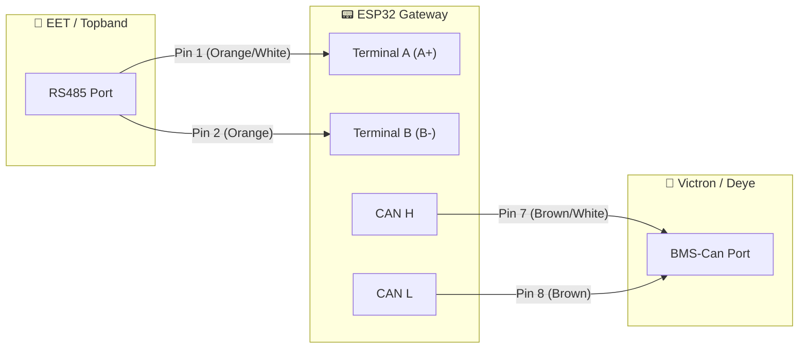

# Hardware and wiring

[Deutsch](hardware.md) · **English**

[← Documentation overview](../README.en.md)

On this page: [Where to buy](#where-to-buy) · [Wiring](#wiring)

## Where to buy

- **Gateway boards:** [LilyGo T-CAN485](https://www.amazon.de/s?k=LilyGo+T-CAN485&tag=atomi23-21)\*, [Waveshare ESP32-S3 RS485/CAN](https://www.amazon.de/s?k=Waveshare+ESP32-S3+RS485+CAN&tag=atomi23-21)\* ([Mini](https://www.amazon.de/s?k=Waveshare+ESP32-S3+RS485+CAN+Mini&tag=atomi23-21)\*, [Power/Pro](https://www.amazon.de/s?k=Waveshare+ESP32-S3+RS485+CAN+Power+Pro&tag=atomi23-21)\*), [M5Stack Basic/Core (Classic)](https://www.amazon.de/s?k=M5Stack+Basic+Core&tag=atomi23-21)\* with [M5Stack Module COMMU](https://www.amazon.de/s?k=M5Stack+Module+COMMU&tag=atomi23-21)\* (includes the MCP2515).
- **Battery examples:** [EET](https://www.amazon.de/s?k=EET+Topband+LiFePO4&tag=atomi23-21)\*, [Power Queen](https://www.amazon.de/s?k=Power+Queen+LiFePO4&tag=atomi23-21)\*, [AmpereTime](https://www.amazon.de/s?k=AmpereTime+LiFePO4&tag=atomi23-21)\*, [Redodo](https://www.amazon.de/s?k=Redodo+LiFePO4&tag=atomi23-21)\*. Check that the specific model has a Topband BMS with RS485.
- **Inverters and GX devices:** [Victron Cerbo GX](https://www.amazon.de/s?k=Victron+Cerbo+GX&tag=atomi23-21)\*, [Victron MultiPlus](https://www.amazon.de/s?k=Victron+MultiPlus&tag=atomi23-21)\*, [Deye](https://www.amazon.de/s?k=Deye+Hybrid+Wechselrichter&tag=atomi23-21)\*, [GoodWe](https://www.amazon.de/s?k=GoodWe+Hybrid+Wechselrichter&tag=atomi23-21)\*, [Growatt](https://www.amazon.de/s?k=Growatt+Hybrid+Wechselrichter&tag=atomi23-21)\*, [SMA Sunny Island](https://www.amazon.de/s?k=SMA+Sunny+Island&tag=atomi23-21)\*. Check which BMS protocol your inverter supports.
- **Accessories:** [Ethernet cable](https://www.amazon.de/s?k=LAN+Kabel+RJ45&tag=atomi23-21)\*, [120 Ω CAN terminator](https://www.amazon.de/s?k=CAN+Bus+Abschlusswiderstand+120+Ohm&tag=atomi23-21)\*, [DC fuse](https://www.amazon.de/s?k=DC+Sicherung+Batterie&tag=atomi23-21)\*, [SD card](https://www.amazon.de/s?k=SD+Speicherkarte&tag=atomi23-21)\*.

\*As an Amazon Associate I earn from qualifying purchases. Links marked * are affiliate/advertising links.

## Wiring

**Safety:** DC fuses are mandatory. Incorrect settings can damage batteries.

- **Protocols:** Victron (default), Pylontech (Deye/GoodWe/Growatt), and SMA Sunny Island.

### Wiring diagram

### 1. Battery to Gateway (RS485)
- Use a standard LAN cable, cut one connector. Use the ORANGE pair:
- Pin 1 (Orange/White) to ESP32 RS485 A (A+)
- Pin 2 (Orange) to ESP32 RS485 B (B-)
- LED stays Blue? Swap A and B!

### 2. Gateway to Inverter (CAN)
- Connect the ESP32 CAN port to the inverter's BMS-Can port.
- ESP32 CAN H to Victron/Deye Pin 7 (Brown/White)
- ESP32 CAN L to Victron/Deye Pin 8 (Brown)
- GND (optional): Pin 3
- Note: Don't forget the Terminator Resistor on the second CAN port of the Victron/Deye and enable the DIP switch (120R) on the Gateway!

Back to [Installation and flashing](installation.en.md).
