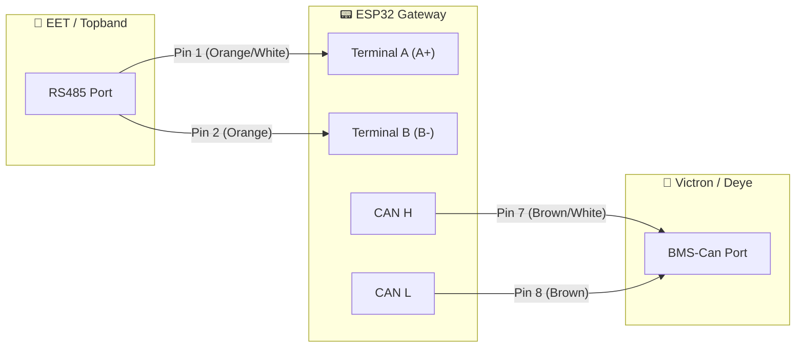

# Hardware and wiring

[Deutsch](hardware.md) · **English**

[← Documentation overview](../README.en.md)

On this page: [Where to buy](#where-to-buy) · [Accessories](#accessories) · [Wiring](#wiring)

## Where to buy

- **Gateway boards:** [LilyGo T-CAN485](https://www.amazon.de/s?k=LilyGo+T-CAN485&tag=atomi23-21)\*, [Waveshare ESP32-S3 RS485/CAN](https://www.amazon.de/s?k=Waveshare+ESP32-S3+RS485+CAN&tag=atomi23-21)\* ([Mini](https://www.amazon.de/s?k=Waveshare+ESP32-S3+RS485+CAN+Mini&tag=atomi23-21)\*, [Power/Pro](https://www.amazon.de/s?k=Waveshare+ESP32-S3+RS485+CAN+Power+Pro&tag=atomi23-21)\*), [M5Stack Basic/Core (Classic)](https://www.amazon.de/s?k=M5Stack+Basic+Core&tag=atomi23-21)\* with [M5Stack Module COMMU](https://www.amazon.de/s?k=M5Stack+Module+COMMU&tag=atomi23-21)\* (includes the MCP2515).
- **Battery examples:** [EET](https://www.amazon.de/s?k=EET+Topband+LiFePO4&tag=atomi23-21)\*, [Power Queen](https://www.amazon.de/s?k=Power+Queen+LiFePO4&tag=atomi23-21)\*, [AmpereTime](https://www.amazon.de/s?k=AmpereTime+LiFePO4&tag=atomi23-21)\*, [Redodo](https://www.amazon.de/s?k=Redodo+LiFePO4&tag=atomi23-21)\*. Check that the specific model has a Topband BMS with RS485.
- **Inverters and GX devices:** [Victron Cerbo GX](https://www.amazon.de/s?k=Victron+Cerbo+GX&tag=atomi23-21)\*, [Victron MultiPlus](https://www.amazon.de/s?k=Victron+MultiPlus&tag=atomi23-21)\*, [Deye](https://www.amazon.de/s?k=Deye+Hybrid+Wechselrichter&tag=atomi23-21)\*, [GoodWe](https://www.amazon.de/s?k=GoodWe+Hybrid+Wechselrichter&tag=atomi23-21)\*, [Growatt](https://www.amazon.de/s?k=Growatt+Hybrid+Wechselrichter&tag=atomi23-21)\*, [SMA Sunny Island](https://www.amazon.de/s?k=SMA+Sunny+Island&tag=atomi23-21)\*. Check which BMS protocol your inverter supports.

\*As an Amazon Associate I earn from qualifying purchases. Links marked * are affiliate/advertising links.

### Accessories

- [USB-A to USB-C data cable](https://www.amazon.de/s?k=USB+A+auf+USB+C+Datenkabel&tag=atomi23-21)\*: For flashing boards with USB-C; charge-only cables do not carry data.
- [5 V USB-A power supply](https://www.amazon.de/s?k=USB+A+Netzteil+5V+2A&tag=atomi23-21)\*: Use with the USB cable to power the [M5Stack Basic](https://docs.m5stack.com/en/core/Basic) or [Waveshare ESP32-S3-RS485-CAN](https://docs.waveshare.com/ESP32-S3-RS485-CAN). USB-A also works with older Basic revisions that do not support USB-C to USB-C.
- [Regulated 9 V DC power supply](https://www.amazon.de/s?k=9V+DC+Netzteil+stabilisiert+Schraubklemmen&tag=atomi23-21)\*: For the DC screw terminal if the board revision supports it. 9 V is within the stated range for the [LilyGo T-CAN485](https://lilygo.cc/products/t-can485) (7–12 V on the product page) and [Waveshare ESP32-S3-RS485-CAN](https://docs.waveshare.com/ESP32-S3-RS485-CAN) (7–36 V). Check the exact board for input voltage and polarity; do not connect this supply to a 5 V USB input.
- [Ethernet cable](https://www.amazon.de/s?k=LAN+Kabel+RJ45&tag=atomi23-21)\*: Use as wire for the RS485/CAN connections below. Do not connect these RJ45 plugs to an Ethernet or PoE port.
- [120 Ω CAN terminator](https://www.amazon.de/s?k=CAN+Bus+Abschlusswiderstand+120+Ohm&tag=atomi23-21)\*: For a CAN bus end that does not already have active built-in termination. Check the connector and pinout.
- [Wire ferrules](https://www.amazon.de/s?k=Aderendhuelsen+feindraehtige+Leitung+Schraubklemmen&tag=atomi23-21)\*: For stranded wire in suitable RS485/CAN screw terminals; select a ferrule that fits the wire gauge and terminal.
- [DC fuse](https://www.amazon.de/s?k=DC+Sicherung+Batterie&tag=atomi23-21)\*: Protects the DC supply wiring; select the voltage, interrupting and current ratings for your installation.
- [microSD card](https://www.amazon.de/s?k=microSD+Karte+32GB+FAT32&tag=atomi23-21)\*: For SD logging on the LilyGo profile (FAT32, up to 32 GB); SD logging is disabled in the Waveshare and M5Stack profiles.

**LED strips and PoE:** The firmware addresses just one NeoPixel (LilyGo: onboard WS2812 on GPIO4; Waveshare profile: GPIO38, no documented strip connector; M5Stack: no NeoPixel). External strips are not directly supported. The documented gateways use Wi-Fi or wired RS485/CAN, not Ethernet/PoE.

## Wiring

**Safety:** DC fuses are mandatory. Incorrect settings can damage batteries.

- **Protocols:** Victron (default), Pylontech (Deye/GoodWe/Growatt), and SMA Sunny Island.

### Wiring diagram

### 1. Battery to Gateway (RS485)
- Use a standard LAN cable, cut one connector. Use the ORANGE pair:
- Pin 1 (Orange/White) to ESP32 RS485 A (A+)
- Pin 2 (Orange) to ESP32 RS485 B (B-)
- LED stays Blue? Swap A and B!

### 2. Gateway to Inverter (CAN)
- Connect the ESP32 CAN port to the inverter's BMS-Can port.
- ESP32 CAN H to Victron/Deye Pin 7 (Brown/White)
- ESP32 CAN L to Victron/Deye Pin 8 (Brown)
- GND (optional): Pin 3
- Note: Don't forget the Terminator Resistor on the second CAN port of the Victron/Deye and enable the DIP switch (120R) on the Gateway!

Back to [Installation and flashing](installation.en.md).
