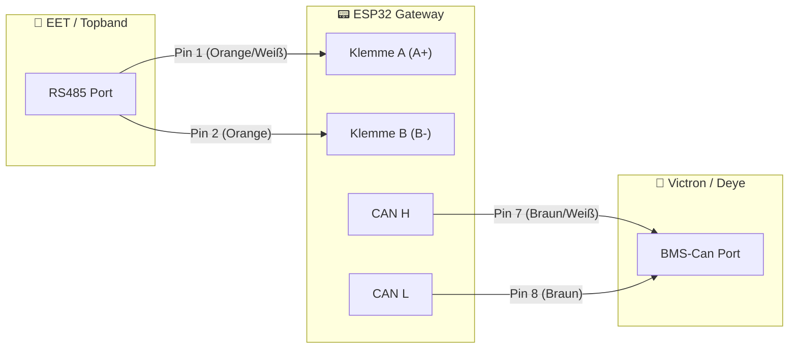

# Hardware und Verkabelung

**Deutsch** · [English](hardware.en.md)

[← Dokumentationsübersicht](../README.md)

Auf dieser Seite: [Bezugsquellen](#bezugsquellen) · [Verkabelung](#verkabelung)

## Bezugsquellen

- **Gateway-Boards:** [LilyGo T-CAN485](https://www.amazon.de/s?k=LilyGo+T-CAN485&tag=atomi23-21)\*, [Waveshare ESP32-S3 RS485/CAN](https://www.amazon.de/s?k=Waveshare+ESP32-S3+RS485+CAN&tag=atomi23-21)\* ([Mini](https://www.amazon.de/s?k=Waveshare+ESP32-S3+RS485+CAN+Mini&tag=atomi23-21)\*, [Power/Pro](https://www.amazon.de/s?k=Waveshare+ESP32-S3+RS485+CAN+Power+Pro&tag=atomi23-21)\*), [M5Stack Basic/Core (Classic)](https://www.amazon.de/s?k=M5Stack+Basic+Core&tag=atomi23-21)\* mit [M5Stack Module COMMU](https://www.amazon.de/s?k=M5Stack+Module+COMMU&tag=atomi23-21)\* (enthält den MCP2515).
- **Batterie-Beispiele:** [EET](https://www.amazon.de/s?k=EET+Topband+LiFePO4&tag=atomi23-21)\*, [Power Queen](https://www.amazon.de/s?k=Power+Queen+LiFePO4&tag=atomi23-21)\*, [AmpereTime](https://www.amazon.de/s?k=AmpereTime+LiFePO4&tag=atomi23-21)\*, [Redodo](https://www.amazon.de/s?k=Redodo+LiFePO4&tag=atomi23-21)\*. Prüfe beim konkreten Modell, ob es ein Topband-BMS mit RS485 hat.
- **Wechselrichter und GX-Geräte:** [Victron Cerbo GX](https://www.amazon.de/s?k=Victron+Cerbo+GX&tag=atomi23-21)\*, [Victron MultiPlus](https://www.amazon.de/s?k=Victron+MultiPlus&tag=atomi23-21)\*, [Deye](https://www.amazon.de/s?k=Deye+Hybrid+Wechselrichter&tag=atomi23-21)\*, [GoodWe](https://www.amazon.de/s?k=GoodWe+Hybrid+Wechselrichter&tag=atomi23-21)\*, [Growatt](https://www.amazon.de/s?k=Growatt+Hybrid+Wechselrichter&tag=atomi23-21)\*, [SMA Sunny Island](https://www.amazon.de/s?k=SMA+Sunny+Island&tag=atomi23-21)\*. Prüfe, welches BMS-Protokoll dein Wechselrichter unterstützt.
- **Zubehör:** [LAN-Kabel](https://www.amazon.de/s?k=LAN+Kabel+RJ45&tag=atomi23-21)\*, [120-Ω-CAN-Abschlusswiderstand](https://www.amazon.de/s?k=CAN+Bus+Abschlusswiderstand+120+Ohm&tag=atomi23-21)\*, [DC-Sicherung](https://www.amazon.de/s?k=DC+Sicherung+Batterie&tag=atomi23-21)\*, [SD-Karte](https://www.amazon.de/s?k=SD+Speicherkarte&tag=atomi23-21)\*.

\*Als Amazon-Partner verdiene ich an qualifizierten Verkäufen. Mit * markierte Links sind Werbe-/Affiliate-Links.

## Verkabelung

- **Sicherheit:** DC-Sicherungen sind Pflicht! Falsche Parameter können Akkus zerstören.

- **Multi-Protokoll:** Victron (Standard), Pylontech (Deye/Goodwe/Growatt), SMA Sunny Island.

### Übersichtsschema

### 1. Batterie zu Gateway (RS485)
- Nimm ein LAN-Kabel, schneide einen Stecker ab. Nutze das ORANGE Paar:
- Pin 1 (Orange/Weiß) an ESP32 RS485 A (A+)
- Pin 2 (Orange) an ESP32 RS485 B (B-)
- Die LED bleibt Blau pulsierend? Tausche A und B!

### 2. Gateway zu Wechselrichter (CAN)
- Verbinde den CAN-Port des ESP32 mit dem BMS-Can des Wechselrichters.
- ESP32 CAN H an Victron/Deye Pin 7 (Braun/Weiß)
- ESP32 CAN L an Victron/Deye Pin 8 (Braun)
- GND (optional): Pin 3
- Hinweis: Vergiss nicht den Terminator-Widerstand am zweiten CAN-Port des Victron/Deye und aktiviere den DIP-Schalter (120R) am Gateway!

Zurück zu [Installation und Flashen](installation.md).
