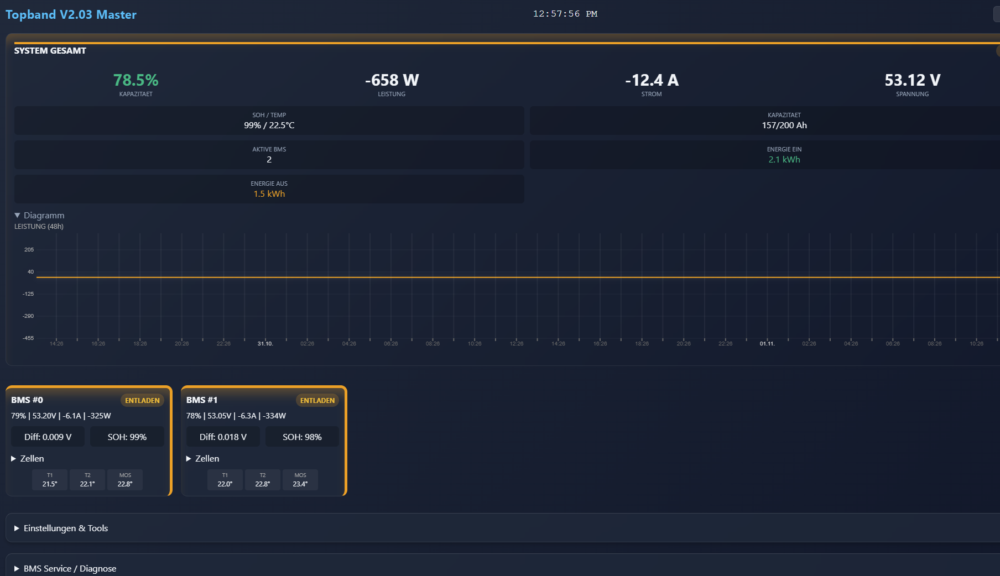
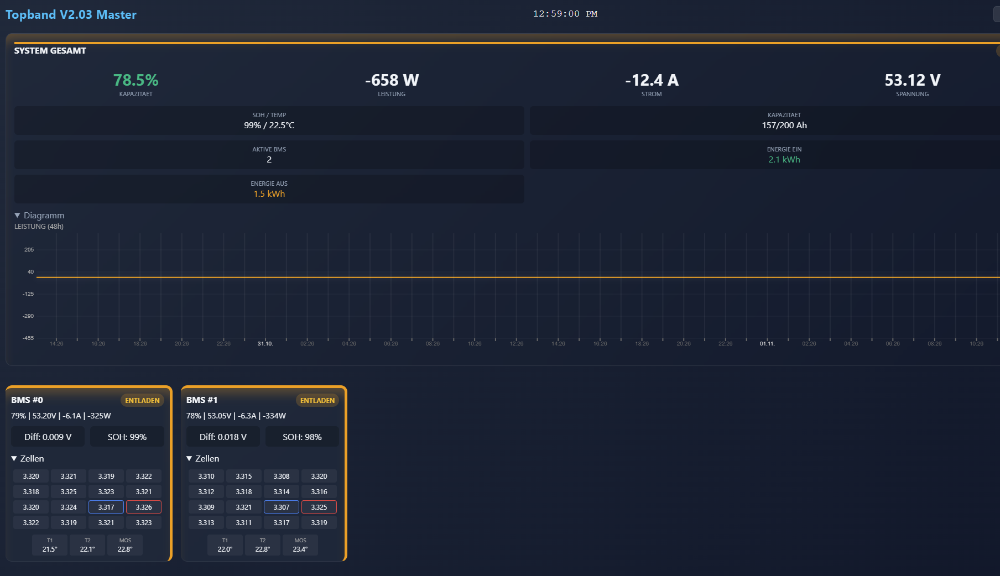
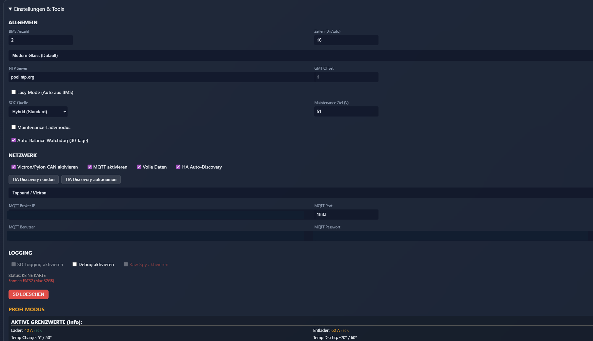
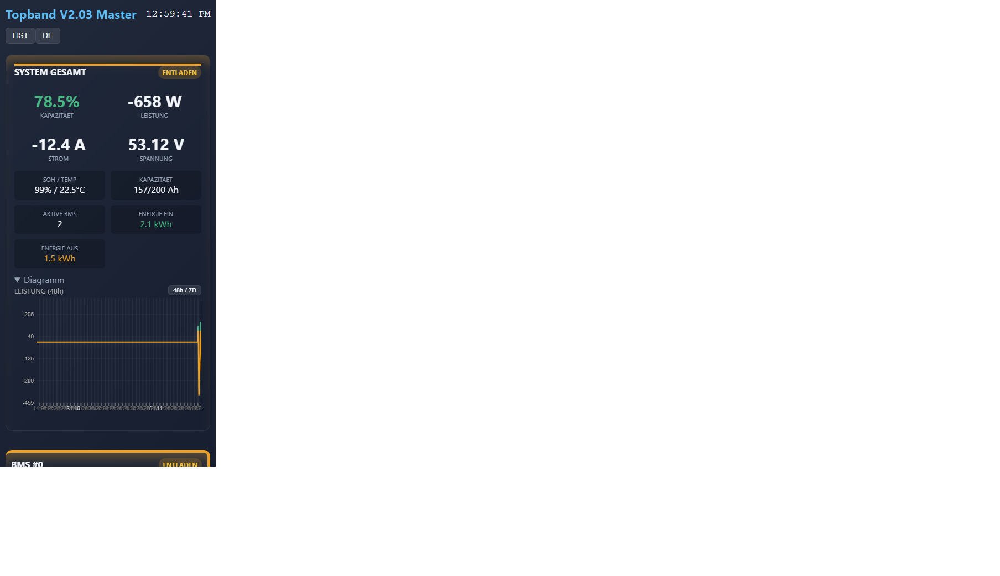

# Web interface and settings

[Deutsch](webinterface.md) · **English**

[← Documentation overview](../README.en.md)

On this page: [Dashboard](#dashboard) · [Thermostat](#thermostat) · [Status LED](#status-led) · [Sherlock and file manager](#sherlock-and-file-manager)

## Dashboard

These screenshots are from an earlier V2.03 build. On current `main`, the percentage tile is labeled **STATE OF CHARGE** in English; **CAPACITY** still shows capacity in Ah. The browser tab (`Topband V2.03`) and dashboard heading (`Topband V2.03 Master`) are generated from `FW_VERSION`.

| Dashboard | BMS Detail |
|---|---|
|  |  |

| Settings | Mobile |
|---|---|
|  |  |

[Wi-Fi, BMS count and cell count on first start](installation.en.md#first-start) · [MQTT and Home Assistant](mqtt.en.md)

## Thermostat

Protects LiFePO4 cells from frozen charging and overheating.
- Split limits: Separate temperature ranges for Charging (e.g., > 5°C) and Discharging (e.g., > -10°C).
- Selectable logic: Choose in "Expert Mode" between "Max Safety" (Worst sensor rules) or "Average" (Average of all sensors).

## Status LED

- 🟣 Purple: Connecting to WiFi...
- 🔵 Blue (Pulsing): Searching BMS / Scanner Mode.
- 🟢 Green (Breathing): System Healthy / Running.
- 🟡 Yellow: Warning (Cell Drift or Limits reached).
- 🔴 Red (Strobe): CRITICAL ALARM (Cutoff / Overheat).

## Sherlock and file manager

- **Spy mode:** Captures unknown raw data to the SD card.
- **Web file manager:** Download or delete logs and files directly in the browser.
