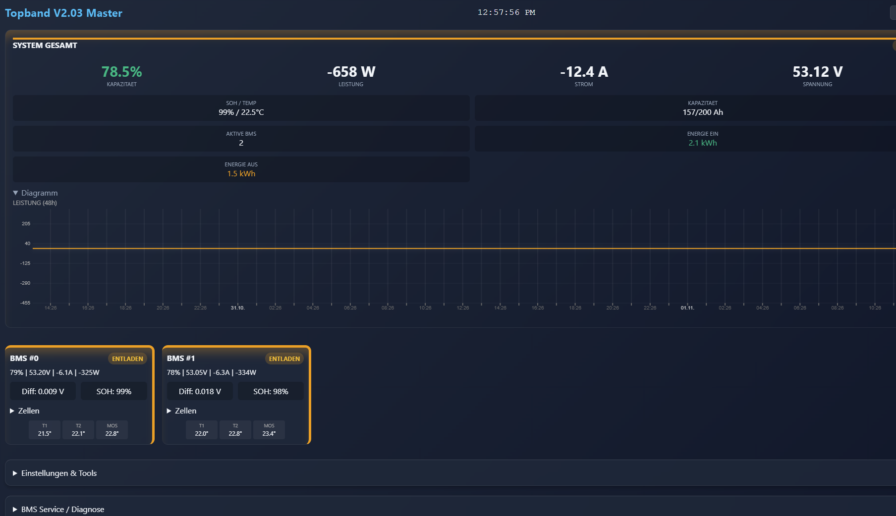
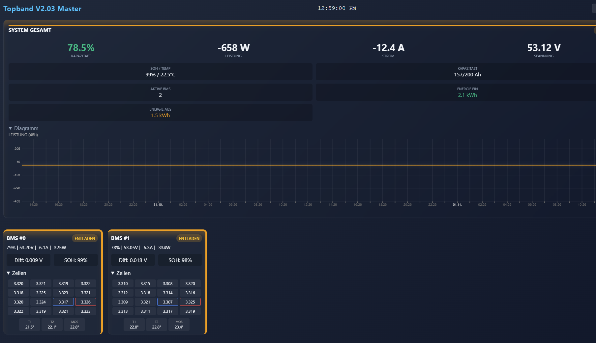
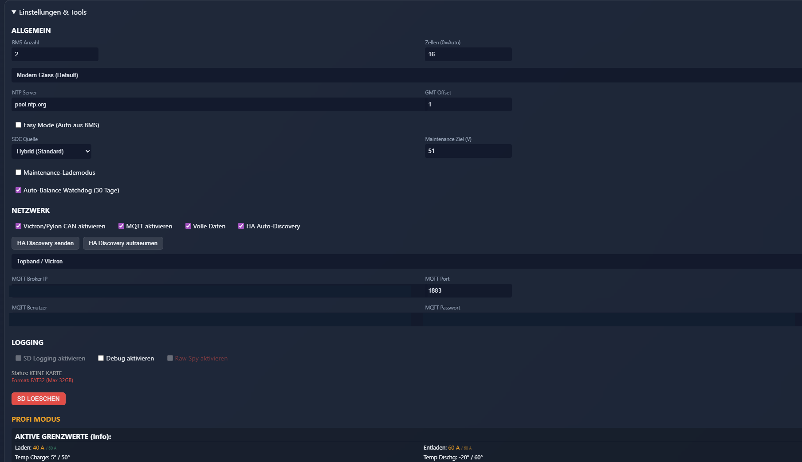

# Webinterface und Einstellungen

**Deutsch** · [English](webinterface.en.md)

[← Dokumentationsübersicht](../README.md)

Auf dieser Seite: [Dashboard](#dashboard) · [Thermostat](#thermostat) · [Status-LED](#status-led) · [Sherlock und Dateimanager](#sherlock-und-dateimanager)

## Dashboard

Die Screenshots stammen aus einem älteren V2.03-Stand. Im aktuellen `main` heißt die Prozent-Kachel **LADESTAND**; **KAPAZITAET** zeigt weiterhin die Kapazität in Ah. Der Browser-Tab (`Topband V2.03`) und die Dashboard-Überschrift (`Topband V2.03 Master`) werden aus `FW_VERSION` gebildet.

| Dashboard | BMS-Details |
|---|---|
|  |  |

| Einstellungen | Mobil |
|---|---|
|  |  |

[WLAN, BMS-Anzahl und Zellanzahl beim ersten Start](installation.md#erster-start) · [MQTT und Home Assistant](mqtt.md)

## Thermostat

Schützt LiFePO4-Zellen aktiv vor Frost-Ladung und Überhitzung.
- **Getrennte Limits:** Separate Temperaturen für **Laden** (z.B. >5°C) und **Entladen** (z.B. >-10°C) einstellbar.
- **Profi-Logik:** Wählbar im Menü:
  - **MAX SAFETY (Standard):** Sobald **ein einziger** Sensor die Grenze reißt (z.B. < 5°C), wird das Laden gestoppt.
  - **AVERAGE:** Der Durchschnittswert aller Sensoren wird genutzt (toleranter).

## Status-LED

- 🟣 **Lila:** Verbinde mit WLAN...
- 🔵 **Blau (Pulsierend):** Suche BMS / Scanner-Modus.
- 🟢 **Grün (Atmen):** Alles OK. System läuft.
- 🟡 **Gelb:** Warnung (Zell-Drift oder Limits erreicht).
- 🔴 **Rot (Blitz):** ALARM (Not-Aus / Schutzabschaltung).

## Sherlock und Dateimanager

- **Spy Mode:** Zeichnet unbekannte Rohdaten auf SD-Karte auf.
- **Web-Manager:** Logs & Dateien direkt im Browser herunterladen/löschen.
